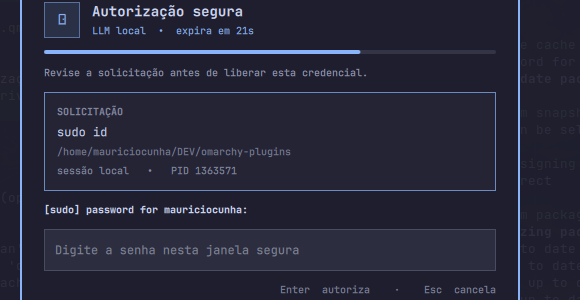

# Doorman

**Local, human-approved `sudo` for background AI agents.**

Doorman is an [Omarchy](https://omarchy.org) plugin for people who run coding
agents (Claude Code, Codex, or anything else that can drive a shell) in
background sessions they aren't watching. When one of those agents needs
`sudo`, there's usually no terminal in front of you to type a password into —
and handing the agent your password so it can type it itself defeats the
point of having one. Doorman puts a human decision in between: the agent's
request shows up in a small, local, keyboard-first window only you can see,
and the password never travels anywhere else — not to the agent, not to the
chat transcript, not to a log file.



## Why this exists

Agentic coding tools are increasingly good at running real commands, and
real commands sometimes need root. The usual answers are all
unsatisfying for local dev work:

- **Give the agent passwordless `sudo`** — fast, but now anything the agent
  runs (including a bug in the agent, or a prompt injection from something
  it read) has unrestricted root.
- **Type the password into the agent's own prompt** — the agent (and
  whatever logs its transcript) now has your password.
- **Babysit every session with a visible terminal** — defeats the purpose of
  running things in the background.

Doorman decouples *where a command asks for a password* from *where you type
it*. The requesting process calls the standard `sudo askpass` protocol; a
small local broker holds the request open and shows it to you; you type the
password into a window the agent has no access to; only that specific,
already-decided-and-verified process gets the secret, once, and only through
that broker connection. If you don't respond, or you're not the person who
actually ran the command, or you hit Escape — it fails closed.

## How it works

```
requesting process (sudo -A)
        │
        ▼
   askpass helper  ──(/run/doorman/askpass.sock, group ACL +      ──►  broker
   (setgid binary)      kernel-checked effective gid)                  (system service)
                                                                      │
                                                       shows the request in
                                                             a Quickshell modal
                                                                      │
                                                              you approve / cancel
                                                                      │
        ◄──────────────────────── secret, once ───────────────────────┘
```

- The **broker** is a small Python system service, running as the dedicated
  `doorman` user, that owns two Unix sockets in `/run/doorman`: one for the
  askpass helper's requests, one for the UI's approve/cancel/status calls.
  Who may connect to each is enforced by the kernel through group
  permissions, and the broker re-checks the connecting process's identity
  itself. It never writes the secret to disk, a log, or its own stdout, and
  there is no session token or other bearer secret to steal.
- Every request carries a random `request_id` and a high-entropy `nonce`,
  expires in 1–300 seconds, and can be consumed exactly once. The broker
  re-validates the requesting process's PID, UID, start time, and command
  line at the moment of approval — not just when the request was created —
  so a PID that's been reused or a process whose identity changed can't
  slip through.
- The **UI** is a Quickshell overlay: a topbar widget for status/history (it is status-only — it does not start
  or stop the service), and
  a modal that grabs keyboard focus, shows exactly what's being authorized
  (command, working directory, PID, terminal), counts down the time left to
  decide, and sends a desktop notification if you're looking at a different
  monitor.
- Approving, cancelling, or letting a request expire are the only three
  outcomes. There is no fourth path where the secret leaks sideways.

See [`SPEC.md`](SPEC.md) for the full protocol, threat model, and the
reasoning behind each security property — including the DoS and timing bugs
we found and fixed while building this.

## Installing

> **Status of this flow.** The system-service design below is implemented
> but has **not yet been verified end to end** on a real machine (real unit,
> real `sudo` round trip, real Quickshell) — that is the last pending step
> before this is offered for review again. The broker runs from a
> root-installed copy under `/usr/local/lib/omarchy-doorman`, not from your
> home checkout. Expect the steps below to change until that is settled.

Doorman has two parts: the **plugin**, an Omarchy bar widget, and the
**broker**, a **system** service (`omarchy-doorman.service`, running as a
dedicated `doorman` user). `omarchy plugin add` handles the first; the
broker needs one root step, and the `sudo` wrapper one more by hand.

```bash
# 1. Add and enable the plugin — validates the manifest, clones it into
#    ~/.config/omarchy/plugins/mauricio.doorman as a git checkout, and
#    places the bar widget without a full shell restart.
omarchy plugin add https://github.com/MauricioMCunha/omarchy-doorman.git --enable

# 2. The one root step. Creates the `doorman` system user and the
#    `doorman-askpass` / `doorman-ui` groups, builds and installs the setgid
#    askpass binary under /usr/local/lib/omarchy-doorman, adds YOU (the
#    sudo-invoking user) to `doorman-ui`, and installs the system unit.
#    Safe to re-run. See "Why this step needs root" below.
sudo ~/.config/omarchy/plugins/mauricio.doorman/scripts/doorman-install-askpass

# 3. Start the broker (and have it start at boot).
sudo systemctl enable --now omarchy-doorman.service

# 4. Shadow `sudo` for this user so agents pick it up without any
#    per-agent configuration — see "Wiring up sudo" below for why this
#    step is the one that actually makes Doorman useful.
ln -s ~/.config/omarchy/plugins/mauricio.doorman/scripts/doorman-sudo ~/.local/bin/sudo

# 5. Log out and back in. Group membership is read at login, so the bar
#    widget (which runs as you, inside Quickshell) cannot reach the broker's
#    control socket until you do.
```

Nothing here replaces `/usr/bin/sudo`, edits `sudoers`, or touches anything
under `/usr/share/omarchy/`. Step 2 is the one exception to "everything else
is unprivileged": it creates a system user and two groups, installs one
small setgid binary (owned by root, not writable by you, outside this
plugin's own git checkout so `omarchy plugin update` never touches it), and
installs a system unit. Every step is explicit and reversible — see
**Activating, updating, and removing** below.

**Exactly one login user.** `doorman-ui` must have exactly one login member:
the broker is pinned to that one user's uid and refuses to start otherwise
(a systemd drop-in that sets `DOORMAN_OWNER_UID` overrides it explicitly).
This is a single-user tool by design.

**The bar widget is status-only.** It shows whether the broker is reachable
and healthy, the pending queue and recent activity, and hosts the approval
modal. It does not start or stop the service — that is `systemctl`, above.
If the broker is down it tells you to run `sudo systemctl enable --now
omarchy-doorman.service`; if the askpass binary is missing or lost its
setgid bit it tells you to run `doorman-install-askpass`.

### Why this step needs root

`sudo` lets *whoever calls it* choose the `SUDO_ASKPASS` helper. Nothing
stops a background agent from invoking real `sudo` directly (bypassing
Doorman's own `sudo` shadow entirely) and pointing `SUDO_ASKPASS` at a
script it wrote itself — which would still look, to the broker, exactly
like a legitimate request, and would receive the real password once a
human approved it. Closing that needs an identity an ordinary, same-user
process cannot fake, and the kernel can provide one:

- The askpass binary is installed once by root, at a fixed path you cannot
  write to, **setgid** to a dedicated group, `doorman-askpass`, that owns
  nothing else and has no human members. Only a process that actually
  executes that file runs with that effective group.
- The broker's request socket is owned by the `doorman` user and the
  `doorman-askpass` group, mode `0660`: the kernel itself refuses to let an
  ordinary process of yours connect to it. The broker then reads the
  connecting process's effective group from `SO_PEERCRED` — recorded by the
  kernel at `connect()`, so exec'ing something else afterwards cannot
  change it — and refuses anything that isn't `doorman-askpass`.
- The broker is a separate system user because a socket owned by *you* would
  let you (and anything running as you) bypass that group check, and because
  a process that can ptrace the broker could do worse. `doorman` owns the
  sockets; you and your agents don't.
- The askpass binary marks itself non-dumpable, so a same-user process
  cannot ptrace it or read its memory while it holds the secret, and, being
  setgid, it ignores `LD_PRELOAD`. It opens no file and connects to a fixed
  socket path.
- The UI talks to a second socket, `control.sock`, owned by `doorman` and
  the `doorman-ui` group — which is why you are added to that group and
  must log out and in.

There is no session token or other bearer secret anywhere in this design.
See [`SPEC.md` §6.13](SPEC.md#613-askpass-identity-is-a-kernel-recorded-credential-the-effective-gid-not-something-the-broker-inspects-or-is-handed)
for the full reasoning and, in its last paragraphs, exactly what has and
has not been verified live — the fork-exec race and the ptrace read of the
secret are closed by design but their live verification is still pending.

### Activating, updating, and removing

The plugin and the broker are independent: toggling one doesn't touch the
other.

```bash
# Toggle the bar widget on/off, without touching the installed files
omarchy plugin disable mauricio.doorman
omarchy plugin enable mauricio.doorman

# Stop/resume the broker, without touching the installed files
sudo systemctl stop omarchy-doorman.service
sudo systemctl start omarchy-doorman.service

# Pull the latest plugin code (it's a git checkout) and restart the broker
# to pick up any broker/ changes — the bar widget's QML hot-reloads on its
# own, the broker does not. The broker runs from a root-installed system copy,
# so `omarchy plugin update` (an unprivileged git pull) does NOT update it:
# re-run the install script (refreshes the system copy and askpass binary),
# then restart the unit.
omarchy plugin update mauricio.doorman
sudo ~/.config/omarchy/plugins/mauricio.doorman/scripts/doorman-install-askpass
sudo systemctl restart omarchy-doorman.service
```

**Removing everything, in order:**

```bash
# 1. Remove the sudo shadow FIRST, before the plugin folder it points into.
#    Only removes it if it's still exactly doorman-sudo.
[ "$(readlink -f ~/.local/bin/sudo 2>/dev/null)" = "$(readlink -f ~/.config/omarchy/plugins/mauricio.doorman/scripts/doorman-sudo 2>/dev/null)" ] \
  && rm -f ~/.local/bin/sudo

# 2. Tear down the system side (while the plugin checkout still exists,
#    since the script lives in it): stops and disables the unit, removes the
#    unit file and the installed askpass binary, removes you from
#    `doorman-ui`, and deletes the `doorman` user and the two groups.
sudo ~/.config/omarchy/plugins/mauricio.doorman/scripts/doorman-install-askpass --uninstall

# 3. Remove the plugin (disables and unloads the widget, then backs up or
#    deletes the plugin folder, since it is a git checkout).
omarchy plugin remove mauricio.doorman --yes

# 4. Log out and back in to drop the stale `doorman-ui` membership.
```

`--uninstall` tolerates a group that is still in use (it prints a notice and
leaves it) and is safe to re-run.

### Wiring up `sudo`

The whole point of Doorman is that an agent shouldn't need to know it
exists. If it only intercepts `sudo` calls that were deliberately routed
through a wrapper, it's back to being a personal habit, not something that
protects anyone who installs it from the catalog without also editing every
agent's own instructions.

`sudo` itself won't cooperate here: given a real terminal to prompt on, it
prefers that terminal over `SUDO_ASKPASS` regardless of what's in the
environment — `-A` has to be passed explicitly, every time, by whatever
calls `sudo`. Since agents (and plain scripts) almost always resolve `sudo`
by name rather than by absolute path, the fix is to make sure they resolve
*Doorman's* `sudo` first:

```bash
# Recommended: shadow `sudo` for this user's own shells only.
# ~/.local/bin generally precedes /usr/bin in PATH already (Omarchy ships
# this by default); this does not touch /usr/bin/sudo, sudoers, or any
# other user's environment.
ln -s ~/.config/omarchy/plugins/mauricio.doorman/scripts/doorman-sudo ~/.local/bin/sudo
```

With that in place, plain `sudo <command>` — typed by you, or run by an
agent in a background job or a terminal it opened itself — resolves to the
wrapper, which always forwards to the real `sudo -A` unless the caller
already passed `-A`/`-S`/`-n`/`--stdin`/`--non-interactive` explicitly. The
one thing this can't catch is a caller that hardcodes `/usr/bin/sudo` by
absolute path, bypassing `PATH` resolution entirely — but since the askpass
identity check (§6.13), that no longer means the secret leaks: a caller
that bypasses the wrapper still can't make its own `SUDO_ASKPASS` receive
the password, so the residual gap is UX only (no friendly retry labeling,
no `DOORMAN_COMMAND` hint) — see
[`SPEC.md`](SPEC.md#7-known-limitations).

Other integration points still exist for narrower cases:

```bash
# One-off, for a single external command, without shadowing sudo at all:
scripts/doorman-run -- sudo systemctl restart some-service

# Or point SUDO_ASKPASS at the installed helper directly, the way a real
# `sudo -A` invocation (or an agent's own shell) would:
export SUDO_ASKPASS=/usr/local/lib/omarchy-doorman/doorman-askpass
sudo -A whoami
```

A process running that installed setgid binary is the only thing the broker
will serve a request to in production (SPEC.md §6.13) — only root's install
step can put a file there, not the plain `askpass.py` in the plugin folder.
`askpass.py` still exists, but only as a dev/test fixture: pointing
`SUDO_ASKPASS` at it gets `untrusted_askpass_helper`, by design.

## What Doorman is not

- Not a secrets vault, and not a password manager. It relays one password,
  once, to one already-verified process.
- Not a keylogger-proofing tool, a sandbox, or a replacement for `sudoers`
  policy — it's a human-in-the-loop gate in front of the normal `sudo`
  mechanism.
- Not (yet) audited by anyone other than the people who built it. See the
  status note below before trusting it with anything that matters.

## Project status

Doorman is in **private beta**: solid enough for the exact workflow it was
built for (local dev machine, one user, background coding agents), not yet
reviewed by anyone outside the project. Current gaps before a wider release:

- CI runs the Python test suite, a compile check, and a secret scan on every
  push; `qmllint` still runs manually (see below) — GitHub-hosted runners
  don't have Quickshell/Omarchy installed, and there's no package for either.
- Tested live against a real Quickshell/Omarchy session and real `sudo` — bar
  widget, popup, the approval modal, and a full `sudo` round trip through the
  wrapper all exercised end to end — but only on an existing, already-set-up
  account. Not yet tested from a clean one: fresh `omarchy plugin add`,
  shell reload, broker toggle, approval, cancellation, expiry, removal, and
  rollback, all on an account that never had Doorman on it before.
- Threat model and plugin lifecycle haven't had an independent review.
- The current identity design (a setgid askpass binary plus kernel-checked
  socket ACLs, [`SPEC.md` §6.13](SPEC.md#7-known-limitations)) is
  implemented and unit-tested, but **not yet verified live** against the
  real system unit, a real `sudo` round trip and a real Quickshell session.
  Until it is, the fork-exec race and the same-user ptrace read of the
  secret are closed by design, not confirmed closed. The install flow also
  has an open deployment item (the broker's code location, see
  **Installing**). Issue #9558 is not reopened until that live verification
  passes.

None of that changes what's already true today: the secret never leaves the
approval path, every request is single-use and identity-checked, and the
broker fails closed on anything it can't verify.

## Development

```bash
python3 -m unittest discover -s tests -p 'test_*.py'
python3 -m py_compile broker/*.py *.py
git diff --check
scripts/qmllint-check  # needs a local Omarchy/Quickshell install
```

The test suite covers the two-socket routing and the effective-gid gate,
owner-uid binding, missing/mismatched PID, expiry, approval, replay, wrong
nonce, cancellation, the askpass helper, process-identity changes, the
idle-connection DoS fix, and the concurrent-request cap. It does not
exercise the real setgid binary, the real socket ACLs or a real Quickshell
session; those are live checks. See [`SPEC.md`](SPEC.md#acceptance-criteria) for the full list
mapped to requirements.

## License

MIT. See [`LICENSE`](LICENSE).
